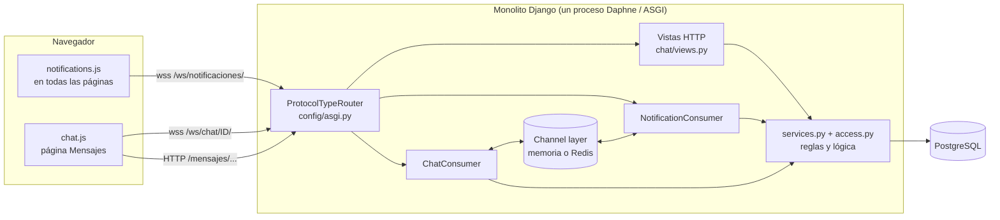
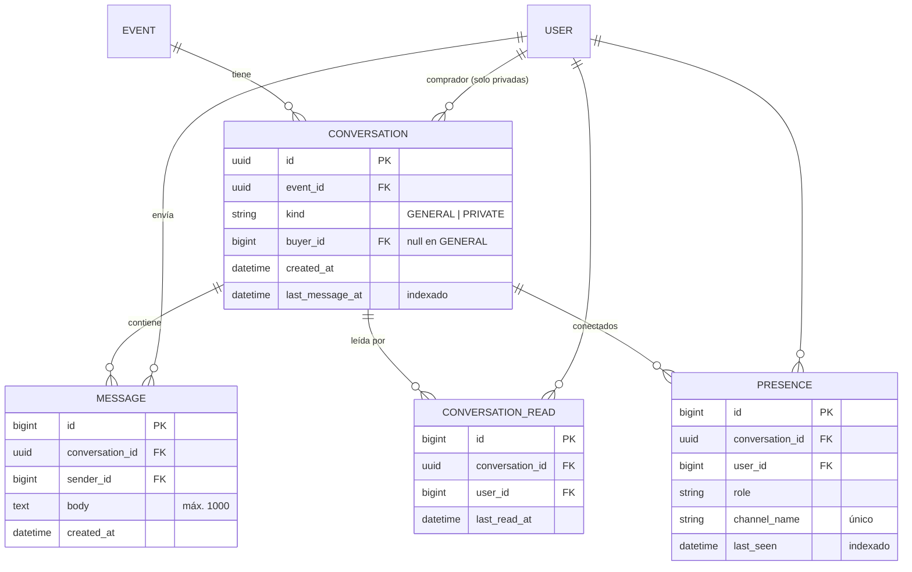
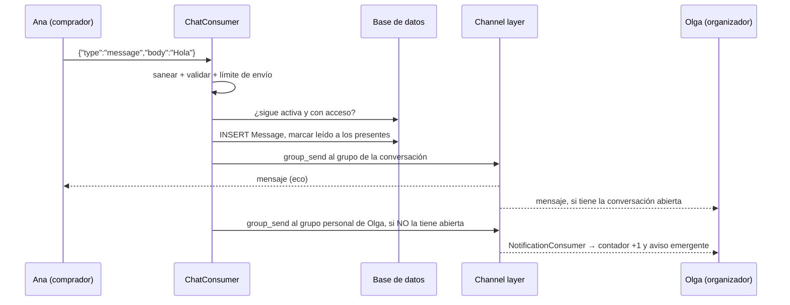

# Módulo `chat` — mensajería en tiempo real con WebSockets

Chat de Ágora Ticket entre los **compradores** de un evento y su **organizador**,
construido con **Django Channels (ASGI)** dentro del mismo monolito. No usa ningún
servicio externo de tiempo real.

> Pasos que debes hacer tú (migración, Render, merge): ver [DESPLIEGUE.md](DESPLIEGUE.md).

## 1. Qué hace

| Funcionalidad | Detalle |
| --- | --- |
| Chat privado 1 a 1 | Cada comprador tiene una conversación privada con el organizador de cada evento del que tiene entrada. |
| Sala general por evento | Una sala por evento donde escriben el organizador y todos los compradores. Cubre el requisito «al menos una sala general». |
| Mensajes en tiempo real | Los mensajes llegan al instante a todos los conectados, sin recargar la página. |
| Historial persistido | Todo mensaje se guarda en la base de datos. Se muestran los últimos 30 y el botón «Cargar mensajes anteriores» pagina hacia atrás. |
| Usuarios conectados | Cada conversación muestra «N conectados: Tú, Ana, Olga (Organizador)». |
| Notificación adicional en tiempo real | **Contador de mensajes no leídos** en el menú «Mensajes» de todas las páginas + aviso emergente (toast) cuando llega un mensaje. |
| Otra notificación de negocio | Cuando un organizador publica un evento, todos los usuarios conectados reciben un aviso emergente «Nuevo evento en cartelera» (lo emite `events/views.py`, lo entrega este módulo). |
| «Está escribiendo…» | Indicador mientras la otra persona escribe. |
| Reconexión | Si se cae la conexión, el navegador reintenta solo y recupera los mensajes perdidos. |

### Quién puede usar el chat

| Rol frente al evento | Sala general | Chat privado | Puede escribir |
| --- | --- | --- | --- |
| **Organizador** del evento | Sí | Sí, con cada comprador | Sí |
| **Comprador** (tiene al menos un ticket `ISSUED` del evento) | Sí | Solo el suyo | Sí |
| **Administrador** (rol `admin`, ajeno al evento) | Sí | Sí | No — modo lectura, para moderar |
| Cualquier otro usuario / visitante | No | No | No |

«Comprador» significa tener un ticket **emitido**. Si el ticket se cancela o
reembolsa, o la cuenta se suspende, el acceso se pierde (incluso con el chat abierto).

## 2. Dónde está en la interfaz

- **Menú «Mensajes»** (navbar, con el contador de no leídos): bandeja de dos paneles,
  lista de conversaciones a la izquierda y chat a la derecha. En móvil se ve una cosa
  o la otra. URL: `/mensajes/`.
- **Detalle del ticket** (`/tickets/<id>/`): botones «Chatear con el organizador» y
  «Sala del evento». El organizador ve «Chatear con el comprador».
- **Detalle del evento**: los mismos botones si el usuario tiene acceso.
- **Mis eventos** (organizador): botón «Chat» → sala general del evento.
- **Inscritos**: botón «Chat» por cada comprador → chat privado con él.
- **Mi panel**: tarjeta «Mensajes».

## 3. Arquitectura



- **Daphne** es el servidor ASGI: atiende HTTP y WebSocket en el mismo puerto y proceso.
- `config/asgi.py` separa el tráfico: HTTP va a Django normal; WebSocket pasa por
  `AllowedHostsOriginValidator` → `AuthMiddlewareStack` → rutas de `chat/routing.py`.
- **Consumer**: clase que maneja una conexión WebSocket (equivalente a una vista).
- **Channel layer**: bus interno con *grupos*. Un consumer envía a un grupo y Channels
  entrega el evento a todas las conexiones suscritas a ese grupo.

### Grupos usados

| Grupo | Quién se suscribe | Para qué |
| --- | --- | --- |
| `chat.<id conversación>` | Cada `ChatConsumer` de esa conversación | Mensajes, presencia, «escribiendo» |
| `user.<id usuario>` | El `NotificationConsumer` de ese usuario (todas sus pestañas) | Avisos de mensaje nuevo y refresco del contador |
| `session.<id usuario>` | Todos los consumers del usuario | Cerrar sus sockets si la cuenta se suspende |
| `notifications` | Todos los `NotificationConsumer` | Aviso de evento publicado (`events/views.py`) |

### Archivos

| Archivo | Responsabilidad |
| --- | --- |
| `models.py` | `Conversation`, `Message`, `ConversationRead`, `Presence`. |
| `access.py` | **Única fuente de permisos**: roles, quién ve qué, consulta de la bandeja y conteo de no leídos. |
| `services.py` | Validar/sanear mensajes, guardarlos, historial paginado, lecturas y presencia. |
| `consumers.py` | `ChatConsumer` y `NotificationConsumer` (WebSocket). |
| `routing.py` | Rutas WebSocket (`/ws/chat/<uuid>/`, `/ws/notificaciones/`). |
| `views.py` / `urls.py` | Bandeja, historial JSON y accesos directos que abren conversaciones. |
| `signals.py` | Cierra los sockets de un usuario cuando se suspende su cuenta. |
| `templatetags/chat_tags.py` | `` para mostrar los botones de chat en otras plantillas. |
| `templates/chat/inbox.html` | Página «Mensajes». |
| `static/chat/chat.js` | Lógica de la conversación abierta y de la lista. |
| `static/chat/notifications.js` | Contador de no leídos y avisos emergentes (se carga en `templates/base.html`). |
| `static/chat/chat.css` | Estilos de la página (usa las variables de `static/css/base.css`). |
| `tests.py` | 24 pruebas automatizadas. |

Cambios fuera de la app: `config/asgi.py` (rutas WebSocket), `config/settings.py`
(`REDIS_URL` opcional), `config/urls.py` (`/mensajes/`), `templates/base.html` (enlace,
contador y script de avisos), `static/css/base.css` (contador y avisos emergentes) y
botones de acceso en las plantillas de tickets, eventos y panel.

## 4. Esquema de base de datos



Restricciones e índices:

- `uq_chat_general_per_event`: una sola sala general por evento.
- `uq_chat_private_per_buyer`: una sola conversación privada por (evento, comprador).
- `chk_chat_kind_matches_buyer`: una sala general no tiene comprador; una privada sí.
- `uq_chat_read_conv_user`: un registro de lectura por (conversación, usuario).
- `idx_chat_msg_conv_created` en `Message(conversation, created_at)`: historial y conteo de no leídos.
- Índices en `Conversation.last_message_at` (orden de la bandeja) y `Presence.last_seen`.

**No leídos** = mensajes de la conversación enviados por *otros* con `created_at`
posterior a `ConversationRead.last_read_at` del usuario. Se calcula en una sola
consulta con subconsultas (`access.conversations_for`).

**Presencia**: una fila por conexión WebSocket abierta. Se guarda en la base (no en
memoria) para que funcione igual con uno o varios procesos. El navegador envía un
latido cada 25 s que renueva `last_seen`; las filas con más de 75 s se ignoran, así
un reinicio del servidor no deja usuarios «fantasma».

## 5. Protocolo WebSocket

Todos los mensajes son JSON con un campo `type`.

### `/ws/chat/<id de conversación>/`

| Dirección | Mensaje | Significado |
| --- | --- | --- |
| Cliente → servidor | `{"type":"message","body":"texto"}` | Enviar un mensaje. |
| Cliente → servidor | `{"type":"typing"}` | Estoy escribiendo (máx. 1 cada 2 s). |
| Cliente → servidor | `{"type":"ping"}` | Latido cada 25 s: renueva la presencia y revalida el acceso. |
| Servidor → cliente | `{"type":"message","id","body","sender_id","sender_name","is_organizer","created_at"}` | Mensaje nuevo (el remitente también lo recibe, como confirmación). |
| Servidor → cliente | `{"type":"presence","users":[{"id","name","role","role_label"}]}` | Lista actual de conectados. |
| Servidor → cliente | `{"type":"typing","user_id","name"}` | Otra persona está escribiendo. |
| Servidor → cliente | `{"type":"error","code","message"}` | `empty`, `too_long`, `invalid`, `rate_limited`, `read_only`, `forbidden`, `unknown_type`. |
| Servidor → cliente | `{"type":"pong"}` | Respuesta al latido. |

### `/ws/notificaciones/`

| Mensaje del servidor | Cuándo |
| --- | --- |
| `{"type":"unread","unread_total","by_conversation"}` | Al conectar y cada vez que el usuario lee una conversación. |
| `{"type":"chat","conversation_id","sender_name","event_name","preview","is_general","conversation_unread","unread_total","by_conversation"}` | Llega un mensaje a una conversación que el usuario **no** tiene abierta. |
| `{"type":"event","event_id","name","category","start_date","message"}` | Un organizador publica un evento. |

Códigos de cierre propios: `4401` (sin sesión / cuenta suspendida) y `4403` (sin permiso).

### Recorrido de un mensaje



## 6. Seguridad

| Medida | Dónde |
| --- | --- |
| **Autenticación en el handshake**: `AuthMiddlewareStack` lee la cookie de sesión de la petición de *upgrade*. Sin sesión válida la conexión se rechaza (HTTP 403) antes de aceptarla. | `config/asgi.py`, `consumers.py` (`connect`) |
| **Autorización por conversación** en el handshake y otra vez **antes de cada mensaje y en cada latido** (se relee al usuario de la base): una cuenta suspendida o un ticket cancelado pierden el acceso con el socket abierto. | `access.conversation_role`, `services.load_access` |
| **Suspensión inmediata**: al desactivar una cuenta se cierran todos sus sockets. | `signals.py` |
| **Origen verificado**: `AllowedHostsOriginValidator` rechaza handshakes desde otros sitios (evita el secuestro de WebSocket entre sitios, el «CSRF» de los WebSockets). | `config/asgi.py` |
| **Validación en servidor**: el mensaje debe ser texto, no vacío, máx. 1000 caracteres; tramas de más de 8000 caracteres o JSON inválido se descartan sin tumbar la conexión. | `services.clean_body`, `consumers._SafeJsonConsumer` |
| **Saneamiento**: se eliminan caracteres de control y de inversión de texto, y se colapsan saltos de línea repetidos. | `services.clean_body` |
| **XSS**: se guarda texto plano y se escapa **al mostrar**: `json_script` y autoescape de Django en la plantilla, y `textContent` (nunca `innerHTML`) en JavaScript. | `inbox.html`, `chat.js`, `notifications.js` |
| **Inyección SQL**: solo ORM de Django (consultas parametrizadas). | — |
| **Anti-spam**: máx. 8 mensajes cada 10 s por conexión. | `consumers.ChatConsumer._rate_limited` |
| **IDOR**: las vistas HTTP devuelven 403 si la conversación no es del usuario; los IDs son UUID. | `views._conversation_or_403` |
| **Privacidad**: a otros usuarios se les muestra el nombre, nunca el correo. | `access.display_name` |
| **wss en producción**: el cliente usa `wss://` cuando la página se sirve por HTTPS. | `chat.js`, `notifications.js` |
| **Validación en cliente**: campo requerido, `maxlength`, contador de caracteres y botón deshabilitado si está vacío o sin conexión. | `inbox.html`, `chat.js` |

## 7. Para la defensa: cómo funciona Channels sobre WebSocket

- **Handshake**: el navegador hace `GET /ws/chat/<id>/` con las cabeceras
  `Upgrade: websocket`, `Sec-WebSocket-Key`, `Origin` y la **cookie de sesión**. Daphne
  lo recibe como tipo `websocket`; el validador de origen y el middleware de
  autenticación se ejecutan y el consumer decide en `connect()`: `accept()` → el
  servidor responde `101 Switching Protocols` y la conexión TCP queda abierta en ambos
  sentidos; `close()` antes de aceptar → responde `403` y no hay conexión.
- **Eventos**: Channels no impone nombres de evento como Socket.IO. Cada trama es
  JSON y el campo `type` decide qué hacer (`receive_json`). Entre conexiones, los
  eventos viajan por el *channel layer*: `group_send(grupo, {"type": "chat.message"})`
  ejecuta el método `chat_message` de cada consumer suscrito.
- **Mecanismos de respaldo**: Channels usa WebSocket puro (RFC 6455); **no** tiene el
  *fallback* a *long-polling* de Socket.IO. La tolerancia a fallos se implementó en el
  cliente: reconexión automática con espera exponencial (1 s, 2 s, 4 s… máx. 30 s), y
  al reconectar pide por HTTP los mensajes posteriores al último recibido
  (`/mensajes/<id>/historial/?after=<id>`). El latido cada 25 s mantiene viva la
  conexión a través de proxies. El historial siempre se puede leer por HTTP.
- **Síncrono vs. asíncrono**: los consumers son `async`; el ORM de Django es síncrono,
  por eso cada acceso a la base se envuelve con `database_sync_to_async`.
- **Channel layer**: en memoria (un proceso) o Redis (varios procesos), según exista
  la variable `REDIS_URL`.

## 8. Pruebas

```powershell
python manage.py test chat --settings=config.test_settings
```

24 pruebas en `chat/tests.py`:

- **Validación** de mensajes (vacío, no texto, muy largo, caracteres de control).
- **Reglas de acceso** por rol, cuenta suspendida y conteo de no leídos.
- **Vistas**: login obligatorio, bandeja, 403 a conversaciones ajenas, apertura de
  chats, historial paginado, escape de HTML.
- **WebSocket de extremo a extremo** contra `config.asgi.application` (con cookie de
  sesión y cabecera `Origin` reales): rechazo de anónimos, de usuarios sin ticket y de
  orígenes ajenos; dos usuarios intercambiando mensajes en tiempo real; persistencia;
  presencia; mensajes inválidos; administrador en solo lectura; suspensión de cuenta;
  notificación de no leídos; aviso de evento publicado.

## 9. Límites conocidos

- La capa en memoria solo sirve con **un** proceso. Para escalar hay que definir
  `REDIS_URL` (ver [DESPLIEGUE.md](DESPLIEGUE.md)).
- Tener la conversación abierta cuenta como «leído», aunque la pestaña esté en segundo plano.
- La bandeja muestra como máximo 100 conversaciones (las más recientes).
- Los mensajes no se pueden editar ni borrar desde la interfaz (sí desde `/admin/`).
